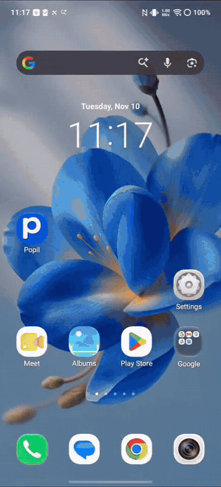
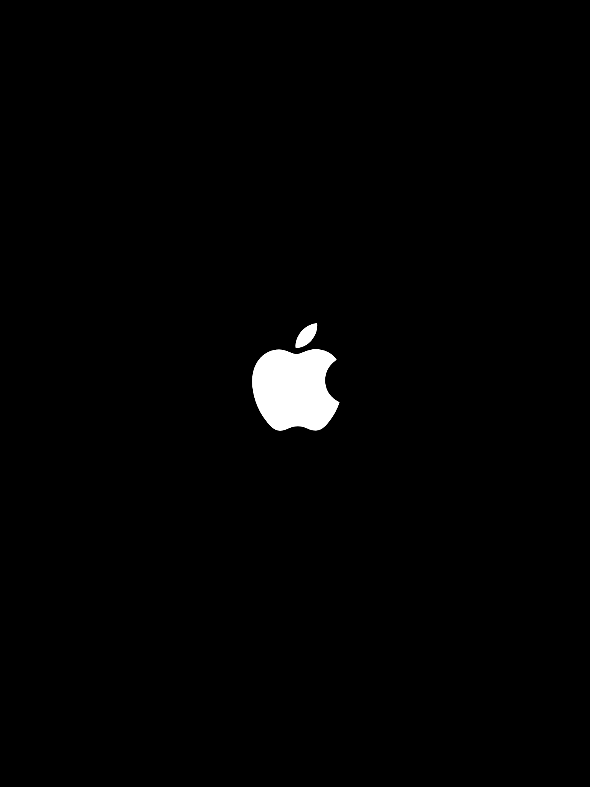
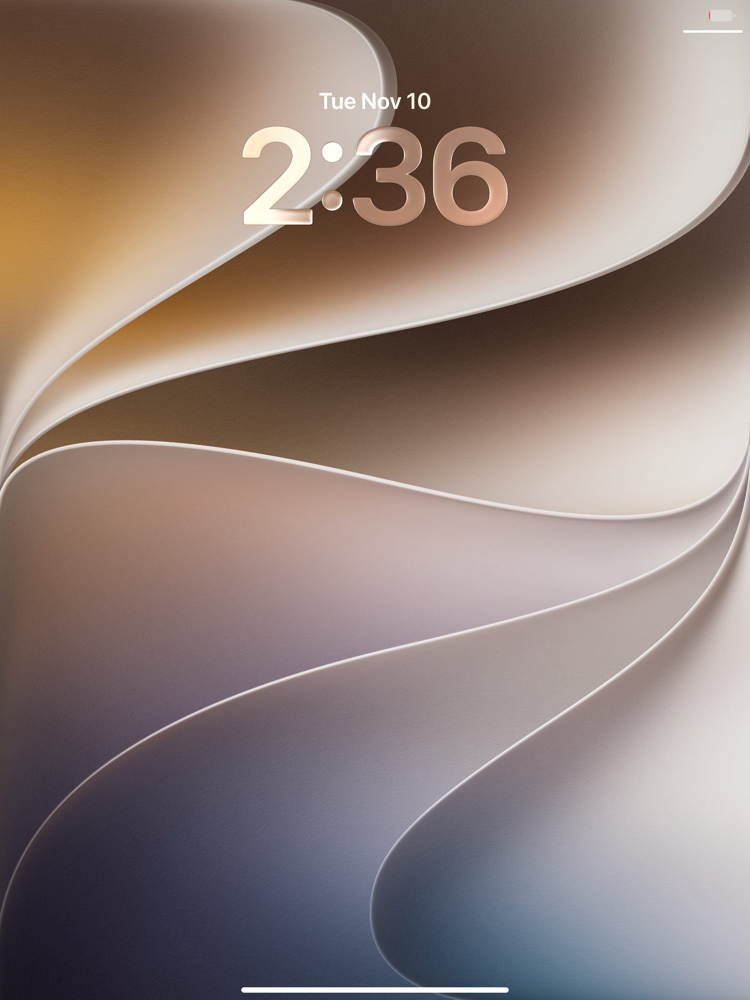
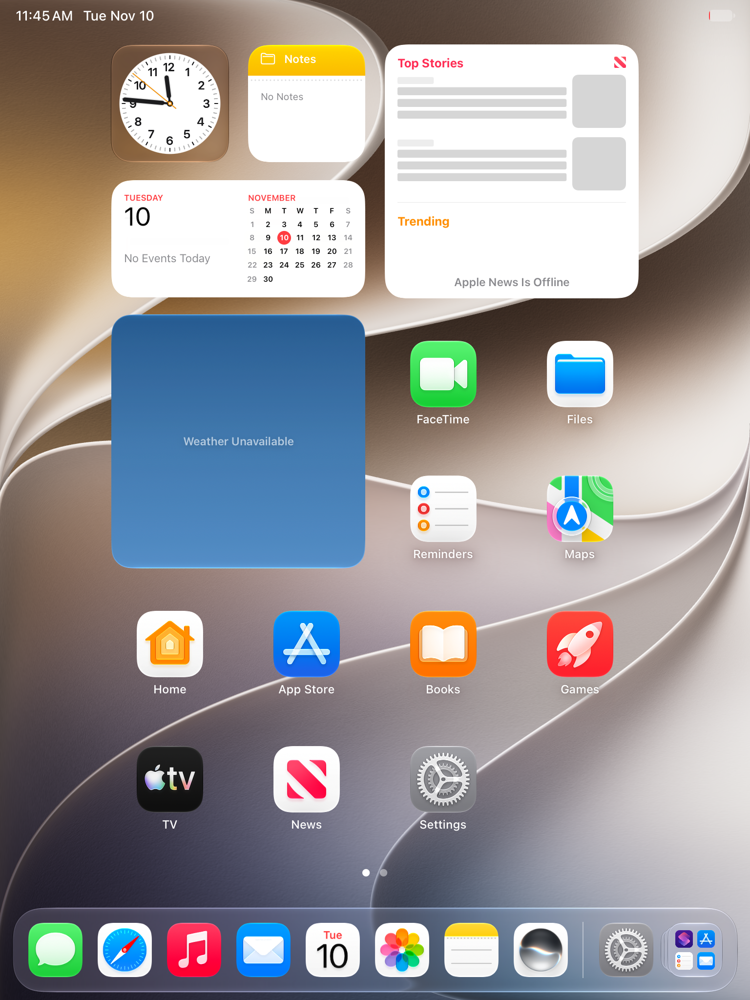
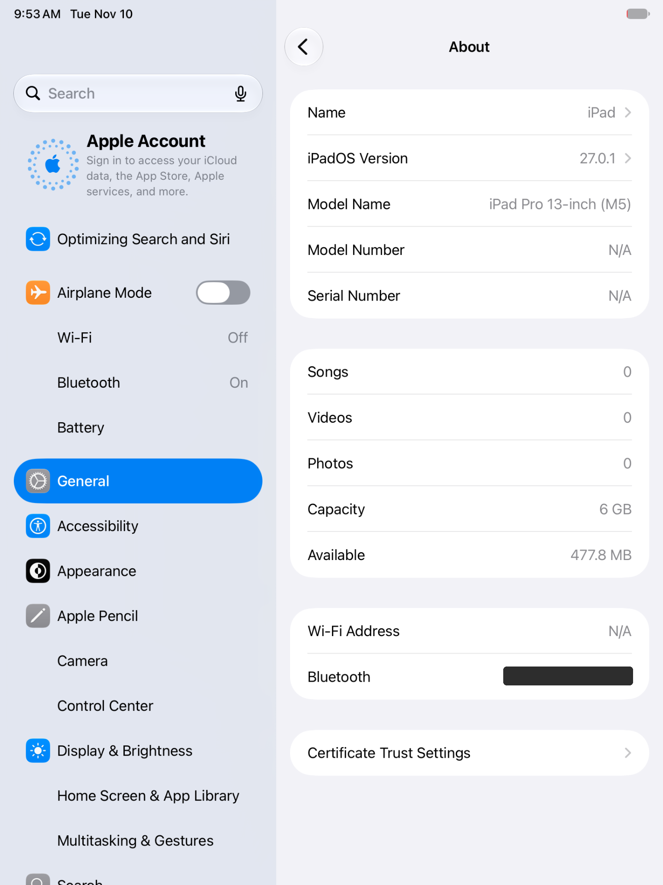
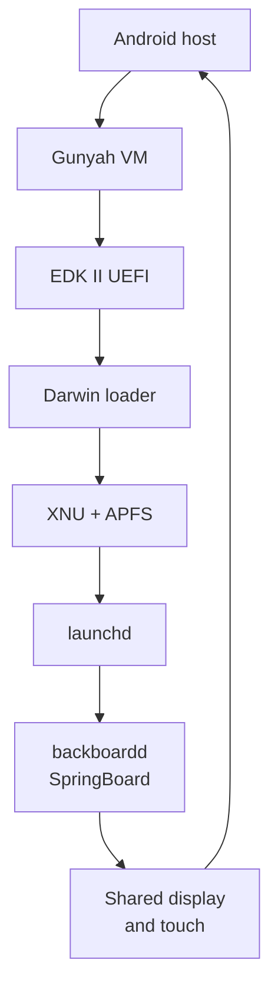
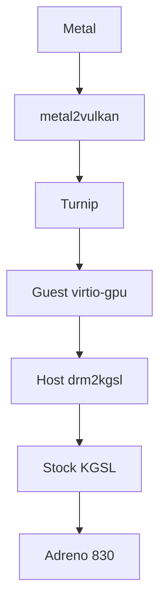

<div align="center">

# iOS · iQOO 13

### iPadOS on Snapdragon. Powered by Gunyah.


**UEFI → XNU → launchd → SpringBoard**

[The story](#the-story) · [Video](#video) · [Screenshots](#screenshots) · [Engineering](#what-i-built) · [Graphics](#the-graphics-path) · [Source guide](docs/BUILD.md)

</div>

## The story

I brought iPadOS 27.0.1 up on an **iQOO 13**, inside a **Gunyah virtual machine**. The guest boots through EDK II UEFI, starts a modified XNU kernel, mounts its APFS volumes and launches the real iPadOS interface: the Apple logo, wallpaper lock screen, SpringBoard home screen and Settings.

I also integrated an **Adreno 830 graphics path** spanning Metal translation, Turnip, a guest virtio GPU driver and an Android KGSL backend. GPU commands, compute and raster workloads execute on the phone's hardware, with completion and readback checks across the guest/host boundary.

The stock Android kernel remains the host. I used temporary root and removable guest files; **I did not flash or replace the stock boot, system or other protected partitions**.

## Video

<p align="center">
  <a href="https://github.com/xAmarnath/iOS-IQOO13/blob/main/assets/video/ipados-demo.mp4">
    
  </a>
</p>

## Screenshots

<table>
  <tr><th>Apple logo</th><th>Lock screen</th></tr>
  <tr>
    <td align="center"></td>
    <td align="center"></td>
  </tr>
  <tr><th>Home screen</th><th>About</th></tr>
  <tr>
    <td align="center"></td>
    <td align="center"></td>
  </tr>
</table>

The About page shows the guest's virtual iPad identity. The physical host is the iQOO 13.

## What I built

| Area | Achievement |
|---|---|
| Firmware | ✅ EDK II UEFI boots inside Gunyah and hands off to the Darwin loader |
| Kernel | ✅ Modified XNU reaches BSD initialization, storage and userspace |
| iPadOS | ✅ `launchd`, `backboardd` and SpringBoard reach the graphical interface |
| CPU | ✅ Two guest vCPUs with separate execution threads, interrupts and timer handling |
| Graphics | ✅ Adreno 830 command execution, fences, readback, compute and raster probes |
| Display | ✅ Apple logo, wallpaper lock screen, home screen and Settings output |
| Input | ✅ Touch events cross from the Android viewer into the guest HID path |
| Storage | ✅ Read-only system disks and a persistent 6 GiB writable APFS Data volume |
| Memory | ✅ Private guest memory and shared I/O memory have separate ownership rules; scattered backing is supported |
| Host isolation | ✅ GPU worker receives shared-memory and IPC handles independently of VM ownership |
| Stock boot | ✅ Android's protected partitions and normal boot path remain intact |

## How it fits together



Gunyah runs at EL2; the Android and XNU kernels run in their own EL1 contexts. The host monitor supplies the virtual devices and manages the guest's memory. Android owns the physical panel and presents the guest through the display app.

### The graphics path



I adapted the graphics stack around the phone's memory and driver interfaces: shared buffer objects, native contexts, queue priorities, bounded IPC, command submission, fences and copied IOSurface backing. The guest can submit real GPU work without owning the physical GPU directly.

The recorded results include **1,024 compute outputs**, triangle rendering, GPU-written canaries and **1,732 checks in the standalone host GPU/IPC suite**, including **30 simultaneous contexts** and three execution/fence cycles. These are workload-level GPU results. The screenshots document graphical boot and navigation; the viewer's 120 Hz setting is a publication ceiling rather than an end-to-end frame-rate measurement.

Read the [graphics implementation](docs/GRAPHICS.md) for the transport, memory and rendering details.

## Resources

The demonstrated two-vCPU graphical profile used:

| Resource | Allocation |
|---|---:|
| Private guest RAM | **2 GiB** |
| Shared graphics pool | **1 GiB** |
| Virtual CPUs | **2** |
| Writable APFS Data | **6 GiB** |
| GPU command window | 16 MiB |
| Guest scanout | 12 MiB · 1536 × 2048 · BGRA8888 |
| Android viewer ring | 36 MiB · three frames |
| GPU response arena | 32 MiB within the graphics pool |

The graphics pool is shared system RAM. Android, Gunyah, page metadata and the viewer also consume memory. The host has 12 GB advertised RAM; swap is separate from the resident pages lent or shared with the VM.

The archive also retains the later **1.5 GiB graphics-pool source checkpoint**. Its configuration and mapping result are separated from the demonstrated profile in [memory and resources](docs/MEMORY.md).

## The engineering behind the screen

- **Memory ownership:** private pages use Gunyah LEND semantics; host-visible devices use SHARE semantics. Host access stays inside the shared regions.
- **Scattered physical memory:** page and folio validation replaces the assumption that the whole guest must occupy one contiguous physical allocation.
- **DMA:** firmware and guest devices use explicitly shared buffers, with checked addresses, lengths and memory attributes.
- **IPC:** descriptor validation, buffer bounds, context limits and resource lifetimes protect the renderer/monitor boundary.
- **SMP:** per-vCPU run state, PSCI handling, timer conversion and interrupt routing let two CPUs participate in the boot.
- **Persistent APFS:** I expanded the writable Data volume to 6 GiB while preserving its contents and boot identity.
- **Presentation:** a sealed triple-buffer shared-memory ring carries completed frames to the Android viewer; touch travels back through an authenticated bridge.
- **Diagnostics:** bounded process inspection, guest stack capture, allocation counters and source/build fingerprints made failures traceable across the boundary.
- **Lifecycle:** memory ownership is retained until VM exit is established. A normal reboot provides a recovery path for a held session.

## Repository layout

```text
assets/screenshots/       Four saved guest captures
assets/video/             MP4 demonstration and animated preview
config/                  Resource profiles and source revision pins
docs/                    Architecture, memory, graphics, builds and results
include/                 Gunyah UAPI and guest graphics ABI
patches/xnu/             Kernel integration and compatibility patches
patches/mesa/            Turnip and compiler changes
patches/metal2vulkan/    Metal translation and resource-lifetime changes
patches/guest/           Shared DMA integration
src/firmware/            EDK II virtio MMIO and DMA support
src/guest/               XNU display, graphics, storage, touch and diagnostics
src/graphics/host/       Android GPU backend, IPC and probes
src/host/                Gunyah monitor and host regressions
src/viewer/              Android display app and native bridges
tests/firmware/          DMA allocator regression fixture
tools/                   Offline host validation
LICENSES/                Component terms and notices
```

### Explore the implementation

| Document | Contents |
|---|---|
| [Architecture](docs/ARCHITECTURE.md) | Boot chain, virtual devices, CPU execution and lifecycle |
| [Graphics](docs/GRAPHICS.md) | Metal/Turnip integration, Adreno backend and scanout |
| [Memory](docs/MEMORY.md) | Address map, ownership, RAM profiles and APFS Data |
| [Build guide](docs/BUILD.md) | Source boundaries, dependencies, component builds and patch series |
| [Results](docs/RESULTS.md) | Recorded boot, graphics, input and storage results |

## Source and licensing

This repository contains source code, integration patches, documentation, screenshots and a demonstration video. **It contains no Apple firmware images, IPSWs, proprietary executables, extracted system libraries, kernel collections or disk images.**

XNU is open source. XNU-related changes retain the applicable Apple Public Source License and existing file notices. Other components retain their own licenses; see [LICENSE](LICENSE) and the [component map](LICENSES/README.md). Original project additions are MIT-licensed where no other component license applies.

iPadOS, Apple, Metal, iQOO, Snapdragon and Adreno are names belonging to their respective owners. This is an independent project.
