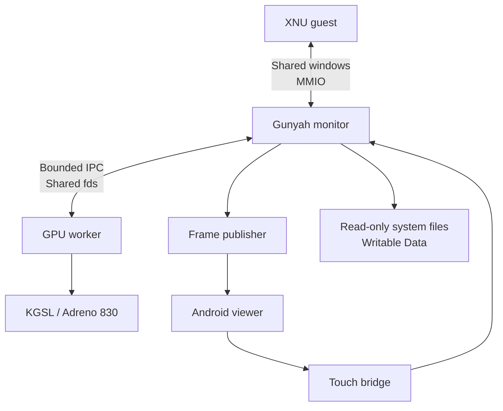

# Architecture

## Machine and execution layers

The physical target is an iQOO 13, model I2401, with Qualcomm SM8750 / Snapdragon 8 Elite and Adreno 830. Its existing Gunyah hypervisor supplies the virtual-machine boundary. Android remains the host OS and supplies the Gunyah userspace API, storage and KGSL driver.

| Layer | Role |
|---|---|
| Gunyah, EL2 | CPU virtualization, guest address spaces and memory ownership |
| Stock Android/Linux, EL1 | Host monitor, KGSL GPU backend, disk files and viewer |
| Guest XNU, EL1 | Virtual platform, APFS, IOKit, process and memory management |
| iPadOS userspace | `launchd`, graphics services, SpringBoard and applications |

The implementation uses the phone's Gunyah interface rather than KVM. Temporary root grants access to the host interfaces; it does not change the device's stock boot selection.

## Boot chain

1. The host monitor allocates and checks private RAM and shared device windows.
2. Firmware, the boot payload and the device tree are loaded before exclusive ownership of private RAM is transferred.
3. Gunyah creates the VM and vCPU interfaces. The first vCPU enters EDK II UEFI.
4. Firmware discovers virtio MMIO disks and uses a restricted shared DMA pool for host-visible transfers.
5. The Darwin loader prepares the modified XNU kernel, platform description and boot arguments.
6. XNU establishes its virtual platform, interrupts, clocks, memory, CPU startup and IOKit services.
7. Source-integrated storage publishes the virtual block devices. APFS supplies the system and writable Data volumes.
8. BSD initialization launches `launchd`. Process compatibility and service policies allow the userspace graph to advance into `backboardd` and SpringBoard.
9. The display/input bridge presents guest output in Android and delivers touch back to XNU.

The userspace target identifies as **iPadOS 27.0.1, build 24A446**. The modified kernel identifies as **Darwin 25.5.0**. The two identifiers describe different layers of the assembled system.

## Virtual platform

The monitor implements bounded MMIO handling for UART, RTC, block devices, diagnostics, touch, display and graphics. Its board description and guest drivers must agree on every address and size.

Four virtio disks provide Boot, OS, SystemOS and Data. The first three are opened read-only. Data is the persistent writable volume. Disk offsets, transfer lengths, queue geometry and shared DMA ranges are checked before host I/O.

The GIC regions supply interrupt delivery; PSCI participates in virtual CPU startup and shutdown. The host counter runs at 19.2 MHz while the guest-facing timebase is 24 MHz, requiring explicit conversion.

## Two-vCPU execution

The two-core profile allocates a separate run page and execution thread per vCPU. Per-thread run state prevents one CPU's MMIO exit from being confused with the other. Locks serialize shared virtual devices; guest barriers and interrupt handling coordinate the CPU views.

Kernel patches address secondary-CPU startup, idle behavior, exception capture, signal delivery, coherency and scheduler diagnostics. Host tests exercise interleavings and CPU migration in the touch/diagnostic paths.

Two vCPUs are scheduled virtual processors. They do not imply permanent exclusive ownership of two physical phone cores.

## Process boundaries

The GPU worker receives the shared resources needed for rendering. VM ownership stays in the monitor: GPU worker failure must not implicitly close VM handles or release lent memory. Input and presentation have distinct authenticated endpoints.

## Display and input

The guest framebuffer is 1536 × 2048, BGRA8888, stride 6144 bytes: 12 MiB per frame. The host publisher copies completed output into a sealed 36 MiB ring. The viewer's JNI/GLES path selects the latest completed frame, avoiding an ever-growing queue of stale frames.

The viewer maps Android coordinates into the guest display coordinates and forwards bounded touch events through the host bridge. The guest worker translates these into the virtual HID path. Unlock, home-screen interaction and Settings navigation were demonstrated with this bridge.

Android continues to own the physical panel. The viewer is the current presentation path; it is distinct from assigning the display controller to XNU.

## Guest compatibility work

The archive groups kernel changes under `patches/xnu/`: platform bring-up, source storage, native page-size compatibility, pointer authentication handling, dyld page inspection, process launch policy, sandbox routing, IOKit class adoption, free-page/compressor thresholds, GPU synchronization and diagnostics.

The guest sources in `src/guest/` implement the virtual platform services and the bridge to the graphics ABI. They are integration units compiled with the corresponding XNU/IOKit platform source, rather than userspace Linux programs.

## Lifecycle and recovery

Private lent memory is inaccessible to the host for the duration of exclusive guest ownership. A VM owner cannot be treated as an ordinary disposable process while that ownership remains live.

The monitor distinguishes terminal exit, cooperative run boundaries and a held/nonresumable state. A time-slice or diagnostic deadline is not proof that the VM exited. CPU workers are joined and terminal evidence is checked before normal teardown; uncertain ownership remains retained. Normal phone reboot provides a system-level recovery path when required.

Runtime host adjustments, including scanner isolation for lent pages, belong to the temporary session. Guest files live in ordinary data storage. Neither deployment nor recovery requires flashing a protected stock partition.
